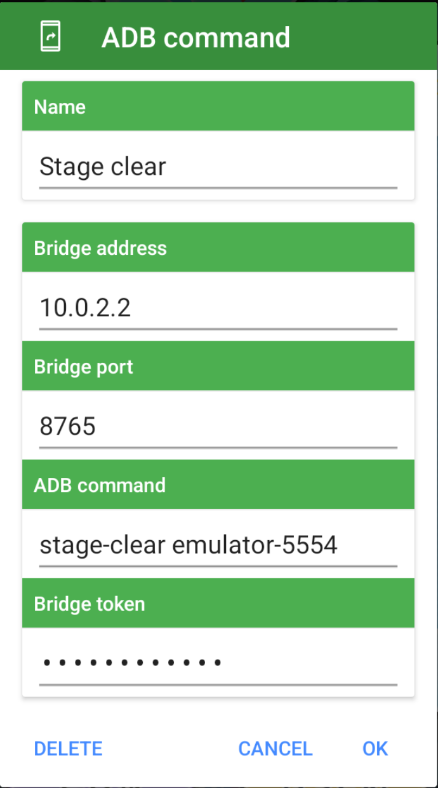
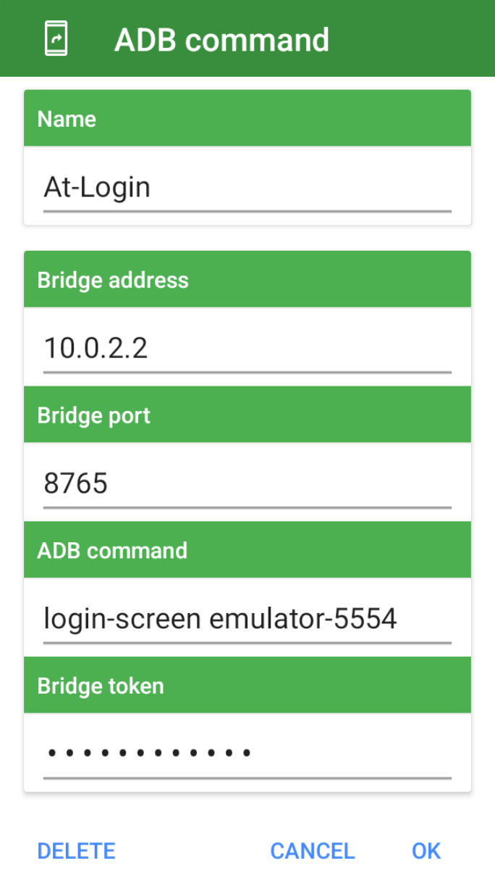

# ADB-YKWP-Dual

Runs two BlueStacks instances of YWPP so that only one plays a stage at a time. When the active
instance clears a stage, the idle one is logged in and the game on the instance that just cleared is stopped to skip
the results animation, roughly halving the time per stage.

Smart AutoClicker on each instance detects what is happening on screen and reports it to this app. The app does the
handoff, watches for a stuck instance, and can send phone alerts through [ntfy.sh](https://ntfy.sh).

## Quick start (already set up)

| System | Command |
|---|---|
| Mac (keeps the Mac awake) | `caffeinate -i -s ~/Downloads/dual-login-macos` |
| Windows | `cd %USERPROFILE%\Downloads` then `dual-login-windows.exe` (also set [sleep to Never](#keep-your-computer-awake)) |
| From source | `python3 main.py` (`py main.py` on Windows) |

Stop it with `Ctrl + C`.

Contents: [What you need](#what-you-need) · [Install on Mac](#install-on-mac) · [Install on Windows](#install-on-windows) ·
[Run from source](#run-from-source-instead-of-the-release) · [Inital Setup](#inital-setup) · [Keep awake](#keep-your-computer-awake) · [Status screen](#the-status-screen) ·
[Integrating with Smart AutoClicker](#integrating-with-smart-autoclicker) · [Settings](#timings-and-settings) ·
[Troubleshooting](#troubleshooting)

## What you need

- Two BlueStacks instances with the game installed.
- **ADB turned on in each instance.** In BlueStacks open **Settings → Advanced** and switch on
  **Android Debug Bridge (ADB)**. Do this in both instances. Without it the app cannot see or control them.
- The Smart AutoClicker build with the ADB action (`smartautoclicker-debug.apk`, attached to the
  [latest release](https://github.com/Whiscake/ADB-YKWP-Dual/releases/latest)), installed in each instance, with
  your own macro that plays the stages.
- Nothing else. No Python and no manual adb install are needed for the release; the app offers to download adb for you.

The app runs in a **terminal window** (Terminal on Mac, Command Prompt on Windows). Keep that window open while you play.
The steps below show how to open it.

## Install on Mac

1. Download `dual-login-macos` from the [latest release](https://github.com/Whiscake/ADB-YKWP-Dual/releases/latest).
   It is built for Apple Silicon (M1 and newer). On an Intel Mac, use [Run from source](#run-from-source-instead-of-the-release).
2. Open **Terminal**: press `Cmd + Space`, type `Terminal`, press Enter.
3. Paste this and press Enter. It makes the file runnable, removes the "downloaded from the internet" flag, and starts it:

   ```bash
   chmod +x ~/Downloads/dual-login-macos && xattr -d com.apple.quarantine ~/Downloads/dual-login-macos && ~/Downloads/dual-login-macos
   ```

**Security prompts.** The app is not signed with an Apple developer certificate, so macOS may block it with
*"cannot be opened because the developer cannot be verified"* if the `xattr` step was skipped. To allow it:
open **System Settings → Privacy & Security**, scroll to the message about `dual-login-macos` and click
**Open Anyway**, then confirm. If macOS asks whether the app may accept incoming network connections, click **Allow**:
the emulators connect to it over your network.

Next time, open Terminal and run `~/Downloads/dual-login-macos` (or wherever you saved it).

## Install on Windows

1. Download `dual-login-windows.exe` from the [latest release](https://github.com/Whiscake/ADB-YKWP-Dual/releases/latest).
2. Double-click it, or run it from a Command Prompt: press `Win + R`, type `cmd`, press Enter, then:

   ```bat
   cd %USERPROFILE%\Downloads
   dual-login-windows.exe
   ```

   Running it from Command Prompt is useful because the window stays open if something goes wrong.

**Security prompts.**
- **Windows protected your PC (SmartScreen):** the app is not code-signed. Click **More info**, then **Run anyway**.
- **Windows Defender Firewall:** when asked, tick **Private networks** and click **Allow access**. If you skip this, the
  emulators cannot reach the app and nothing will happen on a stage clear. To fix it later, open
  *Windows Security → Firewall & network protection → Allow an app through firewall* and allow `dual-login-windows.exe`.

## Run from source (instead of the release)

Use this on Intel Macs, Linux, or if you prefer to run the Python directly. Nothing needs installing besides Python.

1. Install **Python 3.10 or newer** from <https://www.python.org/downloads/>. On Windows, tick *Add python.exe to PATH*.
2. Download the code: on the repo page click **Code → Download ZIP** and unzip it (or run
   `git clone https://github.com/Whiscake/ADB-YKWP-Dual.git`).
3. Open a terminal **in that folder**.
   - **Mac:** open Terminal, type `cd ` (with a space), drag the unzipped folder onto the window, press Enter.
   - **Windows:** open the folder in File Explorer, click the address bar, type `cmd` and press Enter.
4. Run:

   ```bash
   python3 main.py
   ```

   On Windows use `py main.py`.

The first-run steps and everything else below are identical.

## Inital Setup

The first time you start the app (once):

1. If it cannot find `adb`, it asks **"Download it from Google now? [Y/n]"**. Press Enter to say yes.
2. Start **both** BlueStacks instances (with ADB enabled). The app finds them and saves their names, for example
   `emulator-5554` and `emulator-5574`. If it cannot find two, it tells you and lets you try again.
3. It prints a box like this:

   ```
   Bridge address : 192.168.1.20
   Port           : 8765
   Bridge token   : k3jXXXXXXXXXXXX
   Commands       : stage-clear emulator-5554   (on the device emulator-5554)
                    stage-clear emulator-5574   (on the device emulator-5574)
   Settings file  : ...
   ```

   You need these four values for the next step. The token is random and unique to your computer.
4. Add the two commands to Smart AutoClicker on each instance (next section), then press **Enter** in the app.

From then on just run the app again: it remembers everything. Leave the window open while playing.

## Keep your computer awake

The app only works while your computer is awake. If it goes to sleep, the emulators can no longer reach it, handoffs
stop, and no alert is sent. The screen can turn off; the computer must not sleep.

- **Mac:** start the app through `caffeinate`, which blocks sleep for as long as the app runs:

  ```bash
  caffeinate -i -s ~/Downloads/dual-login-macos
  ```

  (`-s` only works while the Mac is plugged in, so keep it on power.)
- **Windows:** open **Settings → System → Power & battery → Screen, sleep, & hibernate timeouts** and set **Sleep** to
  **Never** while plugged in. Laptops should stay plugged in.
- **Linux:** run it through `systemd-inhibit --what=sleep ./dual-login-linux`.

## Integrating with Smart AutoClicker

The app needs to be told what is happening on each device. You do that with an **ADB command** action in your macro.
Both `stage-clear` and `login-screen` are needed for unattended running. In each command, use that instance's own
name (`emulator-5554` on one, `emulator-5574` on the other).

The fields are the same for both; only **Name** and **ADB command** change:

| Field | What to enter |
|---|---|
| Name | Anything, for example `Stage clear` or `At-Login` |
| Bridge address | `10.0.2.2` (the emulator's name for your computer; it never changes). If that does not connect, use the LAN address the app printed, though it can change when your router assigns a new one |
| Bridge port | The port the app printed (default `8765`) |
| ADB command | `stage-clear <name>` or `login-screen <name>`, see below |
| Bridge token | The token the app printed. It must match exactly |

### 1. Stage clear: `stage-clear emulator-5554`



Add this action at the point in your macro where a stage has just been cleared (for example when the clear banner is
detected). This is the command that makes everything happen. When the **active** device sends it, the app:

1. waits a moment (`stage_clear_tap_delay_seconds`, 0.2 s by default)
2. taps login on the **other** (idle) device, which starts playing
3. force-stops the game on the device that just cleared, so you skip the results animation
4. swaps the roles: the other device is now the active one

Clears that arrive too soon after a device started (less than `min_stage_seconds`, default 18 s) are ignored, and so
are clears from the idle device, so repeated or stray events do no harm.

### 2. At login: `login-screen emulator-5554`



Add this action where your macro sees the **login screen** (the login button is visible). Set the action to repeat while
the screen is showing (the macro sends it, waits a few seconds, and sends it again for as long as the login button is
visible). Each send is one `login-screen` report. It tells the app which device is idle.

It also fixes a deadlock: if **both** devices end up sitting on the login screen (after a crash, a restart, or a
missed tap), nobody is playing and no stage clear will ever arrive. When both devices report `login-screen` within
`both_at_login_window_seconds` (default 6 s), the app taps login on one of them to get things going again. The app needs both reports
close together to see this, so the **repeat interval** (the wait between sends) must be **shorter than that window**. If a device
only reports every 10 s, the two reports never overlap and the stuck state goes unnoticed. Login is never tapped from this command when only one device is at
login, because that is the normal idle state.

Every situation, including what happens when something goes wrong, is covered in [GUIDE.md](GUIDE.md).

## The status screen

While the app runs, the terminal shows one live screen of stats

```
ADB-YKWP-Dual                                  2026-11-17 14:45:12
------------------------------------------------------------------
Bridge address : 10.0.2.2 (or 192.168.1.20)   Port: 8765
Bridge token   : <your token>
Devices        : emulator-5554, emulator-5574
Status         : OK - emulator-5554 playing for 12s
------------------------------------------------------------------
This run       : 25 clears | ~450 points | last clear 51s ago
Clear time     : avg 22.0s | fastest 21.0s | slowest 23.0s (last 24)
Uptime (24h)   : 100.0% | downtime 0s
Points         : ~2945/hour | ~70691/24h | by 2026-12-01 01:00: ~949162
------------------------------------------------------------------
Recent warnings: none
```

- **Status** shows `OK` or `STUCK` (no clear for a while).
- **Bridge address, port and token** are always on screen, so you can copy them into Smart AutoClicker any time.
- **Points** are calculated from your average clear time and the points you earn per clear. Tell the app your number
  with `points_per_clear` in `settings.json`. To also see how many points you will have by a certain date, set
  `forecast_target_datetime` (for example `2026-12-01 00:00`).
- **Recent warnings** shows the last few problems, such as a wrong token. Everything is also saved in the log file.
- The full scrolling log is still available: start the app with `--log` (`python3 main.py --log`).

## Timings and settings

All timings and options live in one file, **`settings.json`**. It is created automatically on first run.

### Where it is

| System | Folder |
|---|---|
| Mac | `~/Library/Application Support/dual-login/` |
| Windows | `%APPDATA%\dual-login\` |
| Linux | `~/.config/dual-login/` |

The app prints the exact path of the file in the box at startup. The same folder holds `logs/coordinator.log`, the full log that the status screen is built from.

**Open it on Mac:** in Finder press `Cmd + Shift + G`, paste `~/Library/Application Support/dual-login/`, press Enter,
then right-click `settings.json` → **Open With → TextEdit**.
**Open it on Windows:** press `Win + R`, type `%APPDATA%\dual-login`, press Enter, then right-click `settings.json` →
**Open with → Notepad**.

### How to edit it

1. **Close the app first** (press `Ctrl + C` in its window).
2. Edit the value after the colon and save. Keep the quotes, commas and brackets as they are. Numbers have no quotes.
3. Start the app again. If you change the `port`, change it in both Smart AutoClicker commands too.

To start over from scratch (new token, devices detected again), delete `settings.json` and run the app.

### The settings you are most likely to change

| Setting | Default | What it does |
|---|---|---|
| `min_stage_seconds` | 18 | A stage clear this soon after a device became active is ignored. Set it just under your fastest real stage time |
| `stage_clear_tap_delay_seconds` | 0.2 | Pause between detecting a clear and tapping login on the other device |
| `stuck_after_seconds` | 40 | No clear for this long and the device is logged as stuck |
| `alert_after_seconds` | 240 | No clear for this long and a phone alert is sent (if `ntfy_url` is set) |
| `alert_repeat_seconds` | 300 | Minimum time between repeated alerts |
| `both_at_login_window_seconds` | 6 | Two `login-screen` reports this close together mean both devices are stuck at login |
| `login_retry_seconds` | 8 | Minimum time between login taps made because of `login-screen` |
| `login_button_x`, `login_button_y` | 525, 1187 | Where login is tapped, in device pixels. Change if your resolution differs |
| `port` | 8765 | Port the app listens on |
| `ntfy_url` | blank | Your ntfy.sh topic URL for alerts on your phone. Blank means no alerts |
| `points_per_clear` | 18 | Points you earn per stage clear, used for the points figures on the status screen |
| `forecast_target_datetime` | blank | Optional date like `2026-12-01 01:00` to forecast points by. Blank shows per hour and per day only |

The full list, with every option, is in [GUIDE.md](GUIDE.md#settings-reference-settingsjson).

## Troubleshooting

- **"Found 0 devices":** ADB is not switched on in BlueStacks (Settings → Advanced), or the instances are not running.
  Turn it on in both, start both, then press Enter in the app.
- **Nothing happens on a stage clear:** the emulator cannot reach your computer. Check the bridge address and port, and
  that the firewall allows the app on Private networks. If `10.0.2.2` does not work, try the LAN address the app printed.
- **The log says "wrong bridge token":** the token in Smart AutoClicker does not match the one in `settings.json`.
- **Wrong tap position:** adjust `login_button_x` and `login_button_y`.
- **Security:** the token stops other devices on your network from tapping your emulators. Keep it private and do not
  run the app on untrusted Wi-Fi / networks.
